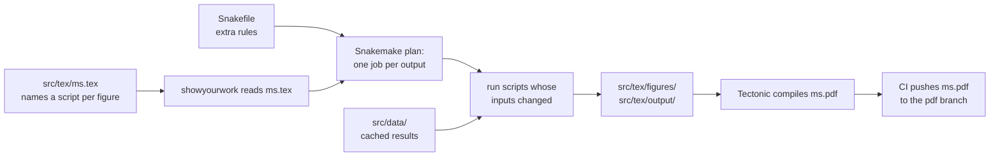

# Reproducible paper template

A LaTeX paper in which figures and results are reproducible and rebuilt from code.
When new code is pushed to `main`, the GitHub Actions workflow rebuilds new figures and the PDF and then publishes it to the
`pdf` branch.

**Latest PDF: [ms.pdf](../../blob/pdf/ms.pdf)** (exists after the first
build on `main`)

The template uses [showyourwork](https://show-your.work), pinned to a
version that works, with fixes for the problems we hit in a real paper. It
also comes with instructions for coding agents (`AGENTS.md`).

## Start a new paper

Clone the template and push it to a new repository of your own. This keeps
the template's history, so you can pull template updates later.
`<template-url>` is wherever this template lives: a GitHub URL or a local
path.

```bash
git clone <template-url> my-paper
cd my-paper
git remote rename origin template
gh repo create my-paper --private --source . --push
```

Without the `gh` CLI, create an empty repository on GitHub, then run
`git remote add origin <its URL>` and `git push -u origin main`.

A private repository is fine. (A GitHub fork of a public repository must stay
public, so do not fork for an unpublished paper.)

Then:

1. Check that Actions run: open the Actions tab of the new repository. The
   first push builds the PDF and creates the `pdf` branch.
2. Replace the examples with your paper. `docs/agents/new-figure.md` has a
   section on removing them.
3. Add paper-specific notes for agents under "This paper" in `AGENTS.md`.

## Build locally

```bash
./build.sh
```

You need only bash, curl, tar, and git. On the first run, `build.sh`
downloads the pinned uv and Tectonic into `.cache/`, creates `.venv/` from
`uv.lock`, downloads the TeX packages, and builds `ms.pdf`. Later runs take
seconds. You do not need a TeX installation or conda.

```bash
./build.sh src/tex/figures/spread.pdf   # build one figure
./build.sh --regenerate                 # recompute cached results in src/data/
./build.sh --dry-run --verbose          # show what would run, and why
```

## How it works



1. In `ms.tex`, each figure names the script that makes it:

   ```latex
   \begin{figure}
     \includegraphics{figures/walkers.pdf}
     \caption{Five random walks.}
     \label{fig:walkers}
     \script{walkers.py}
   \end{figure}
   ```

2. `./build.sh` runs showyourwork. showyourwork compiles `ms.tex` once to
   find every `\script`, `\includegraphics`, and `\variable`, and turns
   them into a [Snakemake](https://snakemake.readthedocs.io) workflow: one
   job per figure, plus any rules in the `Snakefile`.
3. Snakemake runs only the jobs whose outputs are missing or whose inputs
   changed. Generated files go to `src/tex/figures/` and `src/tex/output/`,
   which git ignores.
4. Tectonic compiles `ms.pdf`. Next to each figure caption, the PDF has an
   icon that links to the script on GitHub, at the commit that built it. A
   stamp in the corner gives that commit.
5. On every push to `main`, CI does the same build and force-pushes the PDF
   to the `pdf` branch. Pull requests get a `pdf-pr-<N>` branch and a comment
   with the link.

So the repository holds code and text only, the PDF always matches a commit,
and a reader can go from any figure to the code that made it.

### Output types

The example paper uses each kind once. Build it and read it: it explains
itself.

| Kind                               | Example                   | Where it lives                 | Rule                     |
| ---------------------------------- | ------------------------- | ------------------------------ | ------------------------ |
| Figure, no inputs                  | `src/scripts/walkers.py`  | `\script{}` in `ms.tex`        | inferred                 |
| Figure from data                   | `src/scripts/spread.py`   | `\script{}` + `Snakefile` rule | listed in `Snakefile`    |
| Number or table                    | `src/scripts/results.py`  | `\variable{}` or `\input{}`    | listed in `Snakefile`    |
| Slow result (training, simulation) | `src/scripts/simulate.py` | committed to `src/data/`       | only with `--regenerate` |

Hand-drawn figures go in `src/static/` and are copied in as they are.

## Layout

```
.
├── AGENTS.md                instructions for coding agents
├── README.md
├── build.sh                 build command
├── Snakefile                rules that showyourwork cannot infer
├── showyourwork.yml         showyourwork settings: \input dependencies
├── showyourwork-fixes.smk   template fixes for Snakemake 9
├── pyproject.toml, uv.lock  Python packages for the figure scripts
├── environment.yml          unused placedholder that showyourwork requires
├── docs/agents/             how-to guides for agents (and people)
├── .github/workflows/       CI: build, publish pdf branch, PR previews
└── src/                     the names under src/ are fixed by showyourwork
    ├── tex/
    │   ├── ms.tex, bib.bib
    │   ├── figures/         generated, git-ignored
    │   └── output/          generated numbers and tables, git-ignored
    ├── scripts/             one script per figure, number, or table
    ├── data/                committed inputs and cached results
    └── static/              hand-made figures
```

## Pull template updates

```bash
git fetch template
git merge template/main
```

The template changes only these files, so a merge rarely conflicts:
`build.sh`, `showyourwork-fixes.smk`, `environment.yml`,
`.github/workflows/`, `docs/agents/`, and the top part of `AGENTS.md`.
`pyproject.toml` and `uv.lock` are shared: if they conflict, keep both sets
of dependencies in `pyproject.toml`, then run `uv lock` and commit.

If you started from GitHub's "Use this template" button instead, the first
merge needs `git merge template/main --allow-unrelated-histories`.

## What is pinned, and why

| Tool         | Version          | Where                                  |
| ------------ | ---------------- | -------------------------------------- |
| showyourwork | commit `5bb47a7` | `pyproject.toml`                       |
| uv           | 0.12.24          | `required-version` in `pyproject.toml` |
| Tectonic     | 0.17.0           | `build.sh` and both workflows          |
| Python       | 3.11             | `.python-version`                      |

Older Tectonic versions crash in showyourwork's first LaTeX pass on the
GitHub runner. The showyourwork commit is the one we tested with Snakemake 9.
Change these pins together and test a full build before pushing.

## Protect `main` on GitHub

On a personal GitHub repository, only you and the collaborators you invite
can push. Everyone else can only fork and open pull requests, and only you
can merge them. So keep Settings > Collaborators empty unless a co-author
needs write access.

To also stop force-pushes to `main` and its deletion (including your own
mistakes), add a ruleset. Replace `OWNER/REPO`:

```bash
gh api -X POST repos/OWNER/REPO/rulesets --input - <<'EOF'
{
  "name": "protect main",
  "target": "branch",
  "enforcement": "active",
  "conditions": {"ref_name": {"include": ["~DEFAULT_BRANCH"], "exclude": []}},
  "rules": [{"type": "deletion"}, {"type": "non_fast_forward"}]
}
EOF
```

The ruleset covers `main` only. Leave the `pdf` and `pdf-pr-*` branches
unprotected, because CI force-pushes them. Rulesets on a private repository
need a paid GitHub plan; on a free plan they work on public repositories
only. Pull requests from forks build with a read-only token, so they cannot
publish PDFs or change branches.

## Software, licenses, and citations

The paper cites the software it is built with in its Software section, and the citations are in
`src/tex/bib.bib`.

| Software                                           | Role                           | License                | Cited as     |
| -------------------------------------------------- | ------------------------------ | ---------------------- | ------------ |
| [showyourwork](https://show-your.work)             | turns `ms.tex` into a workflow | MIT                    | `Luger2021`  |
| [Snakemake](https://snakemake.github.io)           | runs the workflow              | MIT                    | `Molder2021` |
| [Tectonic](https://tectonic-typesetting.github.io) | compiles the LaTeX             | MIT                    | `Tectonic`   |
| [uv](https://github.com/astral-sh/uv)              | pins the Python environment    | MIT or Apache-2.0      | `uv`         |
| [NumPy](https://numpy.org)                         | example figure scripts         | BSD-3-Clause           | `Harris2020` |
| [Matplotlib](https://matplotlib.org)               | example figure scripts         | Matplotlib (PSF-based) | `Hunter2007` |

CI also uses `actions/checkout`, `actions/cache`, `actions/upload-artifact`,
`actions/github-script`, and `astral-sh/setup-uv`, all MIT-licensed.
`src/tex/showyourwork.sty` is copied from showyourwork and keeps its MIT
notice.

## License

The template is MIT-licensed; see `LICENSE`. A paper started from the
template inherits that file, so replace it if your paper needs a different
license.
